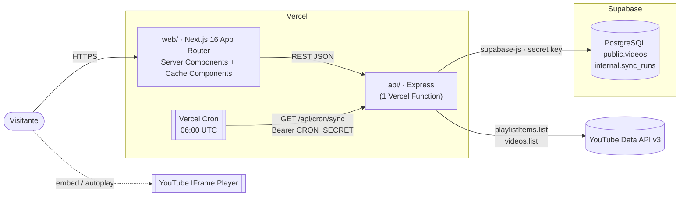
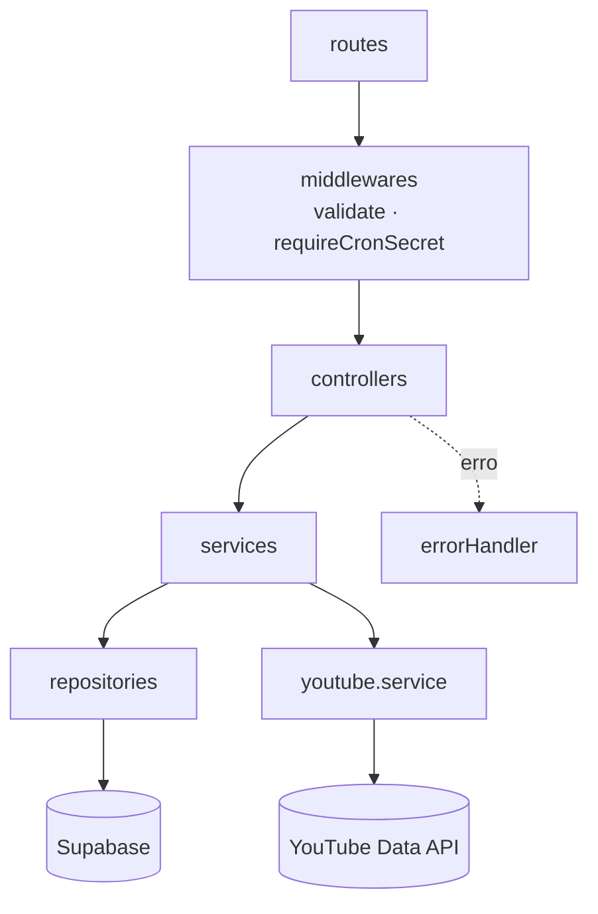
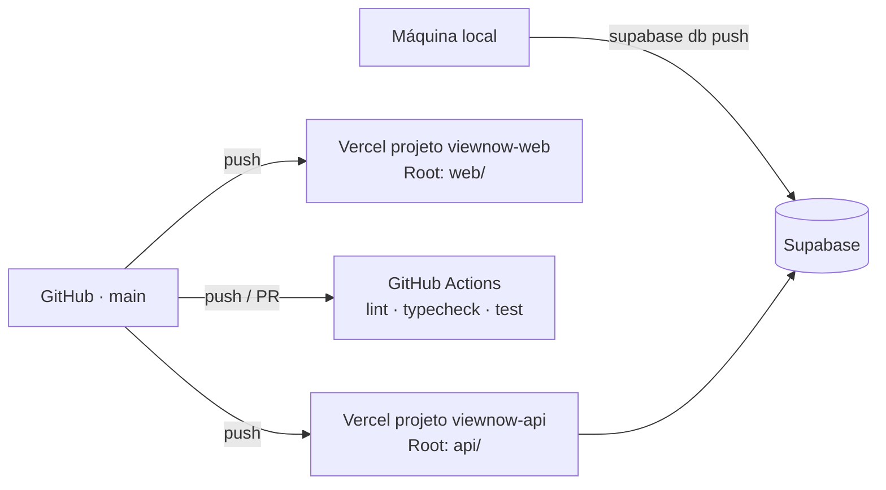

# ViewNow — Arquitetura

Documentos relacionados: [specs.md](./specs.md) · [system-design.md](./system-design.md)

## 1. Visão geral

Três peças desacopladas, no mesmo repositório, com uma regra central: **só a API fala com o YouTube Data API e com o banco**. O front consome a API REST e usa o YouTube apenas para tocar vídeos (IFrame Player).



| Componente | Responsabilidade | Não faz |
| --- | --- | --- |
| `web/` | Renderizar galeria, playlist e player; busca; estados de UI | Não acessa banco nem YouTube Data API; não usa rotas de API do Next |
| `api/` | Sync YouTube → banco; API REST de leitura; autenticação das rotas de sync | Não renderiza HTML; não expõe chaves |
| `supabase/` | Schema, RLS, funções e migrations versionadas | Não é acessado por `anon`/`authenticated` |
| Vercel Cron | Disparar a sync diária | — |

## 2. Estrutura do repositório

```
ViewNow/
├─ api/                         # Projeto Vercel 1 (Root Directory: api/)
│  ├─ src/
│  │  ├─ index.ts               # cria o app Express; export default app; listen só fora da Vercel
│  │  ├─ createApp.ts           # middlewares (cors, json, rotas, erro); não usar app.ts: a Vercel o trataria como entrypoint
│  │  ├─ config/env.ts          # validação das variáveis com zod
│  │  ├─ lib/
│  │  │  ├─ supabase.ts         # cliente com SUPABASE_SECRET_KEY
│  │  │  └─ database.types.ts   # gerado por `supabase gen types`
│  │  ├─ routes/                # videos.routes.ts, sync.routes.ts, health.routes.ts
│  │  ├─ controllers/           # traduz HTTP ⇄ serviço
│  │  ├─ services/
│  │  │  ├─ youtube.service.ts  # fetchPlaylistVideos(playlistId, max)
│  │  │  ├─ sync.service.ts     # orquestra fetch → upsert → prune → log
│  │  │  └─ videos.service.ts   # regras de leitura
│  │  ├─ repositories/
│  │  │  └─ videos.repository.ts
│  │  ├─ middlewares/           # requireCronSecret, validate(zod), errorHandler, notFound
│  │  ├─ errors/AppError.ts
│  │  └─ scripts/sync.ts        # `npm run sync`
│  ├─ tests/
│  │  ├─ fixtures/              # respostas do YouTube salvas em JSON
│  │  ├─ unit/                  # mapeamento e filtros
│  │  └─ routes/                # supertest
│  ├─ vercel.json               # crons
│  ├─ .env.example
│  ├─ package.json
│  └─ tsconfig.json
├─ web/                         # Projeto Vercel 2 (Root Directory: web/)
│  ├─ src/
│  │  ├─ app/
│  │  │  ├─ layout.tsx          # Manrope, Header, Footer, tokens globais
│  │  │  ├─ globals.css         # tokens (:root) e reset
│  │  │  ├─ page.tsx            # Home: hero + galeria (Nível 1)
│  │  │  ├─ loading.tsx / error.tsx / not-found.tsx
│  │  │  ├─ playlist/page.tsx   # Nível 2
│  │  │  └─ video/[youtubeId]/
│  │  │     ├─ page.tsx         # Nível 3
│  │  │     └─ loading.tsx
│  │  ├─ components/            # cada um com seu *.module.css
│  │  │  ├─ Header/ Footer/ Hero/ SearchInput/
│  │  │  ├─ VideoGallery/ VideoCard/ Pagination/
│  │  │  ├─ VideoPlayer/        # 'use client' · react-youtube
│  │  │  ├─ PlaylistPlayer/ VideoList/ InfoCard/ EmbedBlockedNotice/
│  │  │  └─ ui/                 # Button, Badge, Pill, Skeleton, Icon
│  │  ├─ services/api.ts        # getVideos, getVideo, getEmbed
│  │  └─ types/video.ts
│  ├─ next.config.ts            # images.remotePatterns: i.ytimg.com
│  ├─ .env.example
│  └─ package.json
├─ supabase/
│  ├─ config.toml
│  └─ migrations/
│     └─ <timestamp>_init.sql   # schemas, tabelas, RLS, políticas, log_sync_run
├─ docs/                        # specs, arquitetura, system design
├─ .github/workflows/ci.yml     # lint + typecheck + testes (api e web)
├─ .editorconfig
├─ .gitignore
└─ README.md
```

Sem npm workspaces: cada pasta tem seu `package.json` e é implantada de forma independente, o que mantém os dois projetos da Vercel simples.

## 3. Camadas da API



- **routes**: só declaram caminho, middlewares e controller.
- **controllers**: leem `req`, chamam o serviço e formatam `{ data, meta }`. Sem regra de negócio.
- **services**: regras (filtros, mapeamento, sync). Testáveis sem HTTP.
- **repositories**: única camada que conhece o Supabase. Converte `snake_case` ⇄ `camelCase`.
- **errorHandler**: último middleware; converte `AppError`/`ZodError` no formato `{ error: { code, message } }`; erros desconhecidos viram 500 sem vazar stack.

## 4. Arquitetura do front-end

| Rota | Tipo de renderização | Dados | Componentes principais |
| --- | --- | --- | --- |
| `/` | Server Component; dados com `'use cache'` + `cacheLife` (5 min); busca em streaming dentro de `<Suspense>` | `getVideos({ page, limit, search })` | `Hero`, `VideoGallery`, `VideoCard`, `Pagination` |
| `/playlist` | Server Component, `'use cache'` + `cacheLife` (5 min) | `getVideos({ limit: 50 })` | `PlaylistPlayer` (iframe), `VideoList` |
| `/video/[youtubeId]` | Server Component, `'use cache'` + `cacheLife` (5 min) + `generateMetadata` | `getVideo(id)` + `getVideos()` | `VideoPlayer` (client), `InfoCard`, `VideoList` |

- **Server vs Client**: tudo é Server Component, exceto `VideoPlayer` (react-youtube precisa do navegador), `SearchInput` (debounce + `router.replace`) e `Pagination` "carregar mais" se for incremental.
- O Server Component calcula `nextId` e passa como prop para o `VideoPlayer` (funções não atravessam a fronteira Server → Client).
- **Estilo**: CSS Modules por componente + tokens em `globals.css` (`:root`). Nenhuma lib de UI.
- **Fonte**: Manrope via `next/font/google` (self-hosted no build, sem request ao Google em runtime).

## 5. Implantação



| Ambiente | Web | API | Banco |
| --- | --- | --- | --- |
| Local | `localhost:3000` | `localhost:3333` (`tsx watch`) | Projeto Supabase (ou `supabase start` local) |
| Preview | URL de preview da Vercel | URL de preview da Vercel | Mesmo projeto Supabase (somente leitura na prática) |
| Produção | `viewnow.vercel.app` (ou domínio próprio) | `viewnow-api.vercel.app` | Projeto Supabase de produção |

- Cada projeto Vercel usa **Ignored Build Step** (`git diff --quiet HEAD^ HEAD ./`) para só rebuildar quando a própria pasta mudar.
- Migrations são aplicadas manualmente (`supabase db push`) antes do deploy que depende delas.
- Cron declarado em `api/vercel.json` — roda só em produção.

## 6. Decisões de arquitetura (ADRs resumidos)

| # | Decisão | Alternativas consideradas | Motivo |
| --- | --- | --- | --- |
| ADR-01 | Front e back separados em `web/` e `api/` | Next.js full-stack com Route Handlers | Exigência do briefing; mostra uma API REST independente |
| ADR-02 | Express como uma única Vercel Function | Fastify, Hono, servidor em Railway/Render | Suporte zero-config da Vercel; um único provedor; Express é o que o briefing espera de Node |
| ADR-03 | Sync para o banco + leitura sempre do banco | Chamar o YouTube a cada request | Protege a cota, permite curadoria, desacopla disponibilidade do YouTube |
| ADR-04 | Supabase acessado só com secret key no back, RLS negando tudo | Front lendo com publishable key + RLS de leitura | Superfície mínima: nenhuma chave no navegador |
| ADR-05 | Cache por tempo (`'use cache'` + `cacheLife`, 5 min) em vez de revalidação sob demanda | Webhook de revalidação | Revalidação sob demanda exigiria Route Handler no Next (fere ADR-01); dados mudam 1x/dia |
| ADR-06 | CSS Modules + tokens CSS | Tailwind, styled-components | Nativo no Next, zero dependência, tokens do StreamVibe mapeiam 1:1 para variáveis CSS |
| ADR-07 | `react-youtube` isolado em um componente | iframe puro, `@vidstack` | Pedido pelo briefing; isolamento permite trocar por iframe sem afetar o resto |
| ADR-08 | Sem monorepo tooling (Turborepo/workspaces) | Turborepo | Dois apps pequenos sem código compartilhado; menos configuração na Vercel |
