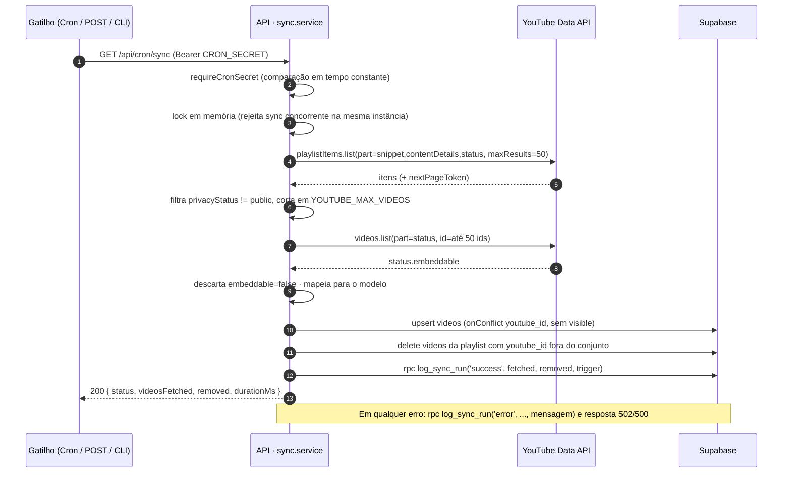
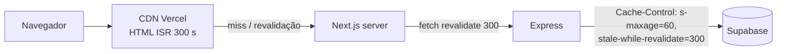

# ViewNow — System Design

Documentos relacionados: [specs.md](./specs.md) · [architecture.md](./architecture.md)

## 1. Requisitos que guiam o design

| Dimensão | Valor esperado | Consequência |
| --- | --- | --- |
| Volume de dados | ≤ 50 vídeos (padrão 20), 1 playlist | Sem necessidade de índices de busca avançados ou cache distribuído |
| Escrita | 1 sync/dia (+ manuais) | Upsert em lote simples; sem filas |
| Leitura | Baixa a moderada (portfólio), picos ao divulgar | ISR no front absorve picos; a API recebe poucas requisições |
| Cota externa | 10.000 unidades/dia no YouTube | Nunca chamar o YouTube no caminho de leitura |
| Consistência | Eventual (até 24 h + 5 min de ISR) | Aceitável: a playlist muda raramente |

## 2. Modelo de dados

```mermaid
erDiagram
    VIDEOS {
        uuid id PK
        text youtube_id UK
        text playlist_id
        text title
        text description
        text thumbnail_url
        text channel_title
        int position
        timestamptz published_at
        boolean visible
        timestamptz created_at
        timestamptz updated_at
    }
    SYNC_RUNS {
        bigint id PK
        timestamptz started_at
        timestamptz finished_at
        text status
        int videos_fetched
        int videos_removed
        text trigger
        text error
    }
```



### 2.1 DDL (migration `init`)

```sql
create extension if not exists pgcrypto;
create schema if not exists internal;

create table public.videos (
  id             uuid primary key default gen_random_uuid(),
  youtube_id     text not null unique check (youtube_id ~ '^[A-Za-z0-9_-]{11}$'),
  playlist_id    text not null,
  title          text not null,
  description    text not null default '',
  thumbnail_url  text,
  channel_title  text,
  position       integer not null,
  published_at   timestamptz,
  visible        boolean not null default true,
  created_at     timestamptz not null default now(),
  updated_at     timestamptz not null default now()
);

create index videos_playlist_visible_position_idx
  on public.videos (playlist_id, visible, position);

create table internal.sync_runs (
  id              bigint generated always as identity primary key,
  started_at      timestamptz not null default now(),
  finished_at     timestamptz,
  status          text not null check (status in ('success', 'error')),
  videos_fetched  integer not null default 0,
  videos_removed  integer not null default 0,
  trigger         text not null default 'manual' check (trigger in ('manual', 'cron', 'cli')),
  error           text
);

-- updated_at automático (função segura, regra 3)
create or replace function public.set_updated_at()
returns trigger
language plpgsql
security invoker
set search_path = public, pg_temp
as $$
begin
  new.updated_at := now();
  return new;
end;
$$;

create trigger videos_set_updated_at
  before update on public.videos
  for each row execute function public.set_updated_at();
```

RLS, políticas negando `anon`/`authenticated` nas 4 operações das duas tabelas, `revoke` de privilégios e a função `public.log_sync_run` (`SECURITY DEFINER`, `search_path = public, pg_temp`, `EXECUTE` só para `service_role`) seguem o SQL de segurança do plano de etapas, com dois parâmetros a mais (`p_videos_removed`, `p_trigger`, `p_started_at`). Também: `revoke usage on schema internal from anon, authenticated`.

### 2.2 Regras de integridade

- `youtube_id` é a chave natural; o upsert usa `onConflict: 'youtube_id'`.
- O payload do upsert **nunca inclui `visible`** → curadoria manual sobrevive às syncs.
- `position` vem da playlist e é reescrito a cada sync (a ordem do YouTube é a fonte da verdade).

## 3. Fluxo de sincronização



**Custo por sync**: 1 chamada `playlistItems.list` + 1 chamada `videos.list` = **~2 unidades** (cota 10.000/dia).

**Proteções**

- Se o YouTube devolver **0 vídeos válidos**, a sync aborta sem apagar nada (evita esvaziar o banco por erro transitório ou chave revogada).
- Upsert + delete são executados em sequência; se o delete falhar, o upsert já aplicado é seguro (o estado fica apenas com vídeos a mais).
- Timeout de 10 s por chamada ao YouTube (`AbortController`); a função da Vercel tem folga (até 60 s+ com Fluid Compute).

**Tratamento de erros do YouTube**

| HTTP / reason | Causa | Código interno | Resposta |
| --- | --- | --- | --- |
| 400 `keyInvalid` | Chave inválida | `YOUTUBE_AUTH` | 502 + log |
| 403 `quotaExceeded` | Cota diária | `YOUTUBE_QUOTA` | 503 + log |
| 404 `playlistNotFound` | ID errado / playlist privada | `YOUTUBE_PLAYLIST_NOT_FOUND` | 502 + log |
| timeout / 5xx | Instabilidade | `YOUTUBE_UNAVAILABLE` | 502 + log |

## 4. Contratos da API

Base: `/api`. Todas as respostas são JSON, `Content-Type: application/json; charset=utf-8`.

### `GET /api/videos`

| Query | Tipo | Padrão | Regra |
| --- | --- | --- | --- |
| `page` | int | 1 | ≥ 1 |
| `limit` | int | 12 | 1–50 |
| `search` | string | — | trim, 1–100 chars; `ILIKE '%termo%'` em `title` (curingas `%`/`_` escapados) |

```json
{
  "data": [
    {
      "id": "6b1c...",
      "youtubeId": "jIfogFtgV-o",
      "title": "Noragami Opening 2",
      "thumbnailUrl": "https://i.ytimg.com/vi/jIfogFtgV-o/hqdefault.jpg",
      "channelTitle": "Canal",
      "position": 0,
      "publishedAt": "2015-10-03T12:00:00Z"
    }
  ],
  "meta": { "page": 1, "limit": 12, "total": 20, "totalPages": 2 }
}
```

### `GET /api/videos/:id`

`:id` = uuid **ou** `youtube_id` (regex decide qual coluna consultar). Retorna o item da lista + `description`. `404 NOT_FOUND` se não existir ou `visible = false`.

### `GET /api/videos/:id/embed`

```json
{ "data": { "youtubeId": "jIfogFtgV-o", "embedUrl": "https://www.youtube.com/embed/jIfogFtgV-o?autoplay=1" } }
```

### `POST /api/sync` e `GET /api/cron/sync`

Header obrigatório `Authorization: Bearer <CRON_SECRET>` → `401 UNAUTHORIZED` se ausente/errado.

```json
{ "data": { "status": "success", "videosFetched": 20, "removed": 1, "durationMs": 1840 } }
```

### `GET /api/health`

`200 { "status": "ok", "db": "ok", "time": "..." }` ou `503 { "status": "degraded", "db": "error" }` (consulta `select 1` leve via `head: true`).

### Erros

| HTTP | `code` | Quando |
| --- | --- | --- |
| 400 | `VALIDATION_ERROR` | Query/params inválidos (zod) |
| 401 | `UNAUTHORIZED` | Sync sem secret válido |
| 404 | `NOT_FOUND` | Vídeo inexistente / rota inexistente |
| 409 | `SYNC_IN_PROGRESS` | Sync já rodando na instância |
| 502/503 | `YOUTUBE_*` | Falha na API do YouTube |
| 500 | `INTERNAL_ERROR` | Qualquer erro não previsto (sem stack na resposta) |

## 5. Cache e desempenho



| Camada | Estratégia |
| --- | --- |
| Páginas Next | `fetch(..., { next: { revalidate: 300 } })`; `/` vira dinâmica quando há `?search` |
| API | `Cache-Control: public, s-maxage=60, stale-while-revalidate=300` nas rotas GET de vídeos; `no-store` em sync e health |
| Imagens | `next/image` com `i.ytimg.com` em `remotePatterns`; `sizes` corretos no grid; `priority` só no hero |
| Fonte | `next/font` (self-hosted, `display: swap`) |
| Player | `react-youtube` carregado só na página do vídeo (`dynamic()` se necessário) |

Latência esperada: ~50–150 ms por consulta ao Supabase (mesma região da função — escolher `gru1`/São Paulo ou `iad1` alinhado à região do Supabase).

## 6. Segurança

| Ameaça | Controle |
| --- | --- |
| Acesso direto ao banco com chave pública | RLS + políticas `false` para `anon`/`authenticated` em tudo; `revoke all`; `internal` fora de Exposed schemas |
| Vazamento da secret key | Só em `api/.env` e env da Vercel (projeto API); validação com zod no boot; `.env*` no `.gitignore`; secret scanning/push protection do GitHub |
| Abuso das rotas de sync (queima de cota) | `CRON_SECRET` com comparação `crypto.timingSafeEqual`; lock contra concorrência |
| Abuso das rotas de leitura | Limite de `limit` (50), `search` ≤ 100 chars; rate limit da Vercel Firewall (ex.: 100 req/min por IP em `/api/*`) |
| SQL injection / curingas | supabase-js parametrizado; escape de `%` e `_` no `ILIKE` |
| CORS | Allowlist por `CORS_ORIGIN` (lista separada por vírgula); sem `*` |
| Cabeçalhos | `helmet` na API; no Next, `Content-Security-Policy` com `frame-src https://www.youtube.com https://www.youtube-nocookie.com` e `img-src https://i.ytimg.com` |
| Auth do Supabase não usado | Cadastros desligados, confirmação de e-mail, Turnstile, Redirect URLs exatas |
| Regressão de segurança | Security Advisor do Supabase antes de cada release; SSL obrigatório; Network Restrictions |

## 7. Observabilidade

- **Logs estruturados** (JSON em `console`) com `requestId`, rota, status e duração → visíveis em Vercel Logs.
- **Histórico de sync** em `internal.sync_runs` (consultável no SQL Editor).
- **Health check** em `/api/health` para monitor externo (ex.: UptimeRobot a cada 5 min).
- **Web**: Vercel Analytics / Speed Insights para Core Web Vitals.

## 8. Modos de falha

| Falha | Comportamento |
| --- | --- |
| YouTube fora / cota estourada | Sync falha e é registrada; site segue servindo o último estado do banco |
| Supabase fora | API devolve 503; páginas ISR continuam servindo o último HTML gerado (stale) até o banco voltar |
| API fora | Páginas em cache continuam no ar; navegação nova cai em `error.tsx` com "Tentar de novo" |
| Vídeo não incorporável não detectado | Player emite erro 101/150 → `EmbedBlockedNotice` com link para o YouTube; mantenedor marca `visible = false` |
| Cron não executa | Dados ficam até 1 dia defasados; `POST /api/sync` manual resolve |

## 9. Estratégia de testes

| Nível | Ferramenta | Cobertura mínima |
| --- | --- | --- |
| Unitário (api) | Vitest | Mapeamento, filtros (privado/embeddable), corte por limite, paginação do YouTube com fixtures |
| Rota (api) | Vitest + supertest (repositório mockado) | Lista, paginação, busca, 404, 400, sync sem/com secret |
| Componente (web) | Vitest + React Testing Library | `VideoCard`, `VideoGallery` (vazio/lista), `EmbedBlockedNotice` |
| E2E (opcional) | Playwright | Home → clicar card → player na página do vídeo |
| CI | GitHub Actions | `lint`, `typecheck`, `test` em `api/` e `web/` a cada push/PR |

## 10. Evolução futura

- Múltiplas playlists (coluna `playlist_id` já existe) com filtro por "categoria" na UI, aproveitando os carrosséis do StreamVibe.
- Rota protegida para marcar `visible = false` automaticamente quando o player reportar 101/150.
- Busca com `pg_trgm` / full-text se o catálogo crescer.
- Lock distribuído da sync via `pg_advisory_lock` dentro de uma função `SECURITY DEFINER`.
